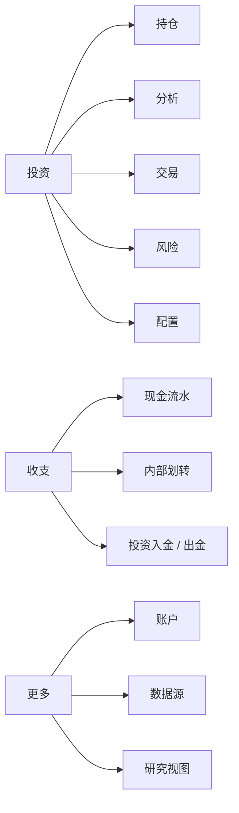
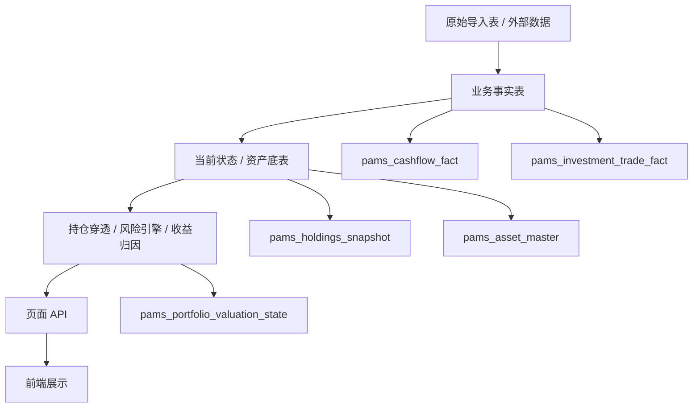
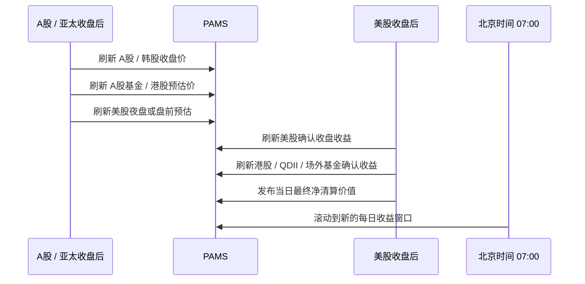

# PAMS 个人资产管理系统


PAMS 是一个本地化个人资产管理系统，用来统一管理银行卡、现金账户、券商账户、A 股、港股、美股、韩国股票、场外基金、贵金属、非上市权益、融资负债和投资流水。

它不是一个简单的资产看板，而是一套围绕“事实表、统一估值、统一收益、统一风险、统一配置”的个人投资数据系统。

## 一句话口径

```text
组合顶层价值 = 已发布净清算价值
净清算价值 = 总资产 - 总负债
美股账户 = IBKR 净清算价值，不使用毛持仓市值
每日收益 = 北京时间 07:00 滚动的自然日窗口
交易事实 = pams_investment_trade_fact
现金事实 = pams_cashflow_fact
当前持仓 = pams_holdings_snapshot
风险和配置 = 消费统一服务层结果，不直接重算
```

## 解决什么问题

| 问题 | PAMS 的处理方式 |
| --- | --- |
| 多账户资产分散 | 统一汇总银行卡、现金账户、券商账户、ESOP 和负债 |
| 美股杠杆容易重复计值 | 使用 IBKR 净清算价值，不把毛持仓市值当组合净资产 |
| 亚太和美股跨时区 | 每日收益按北京时间自然日统一对齐，早上 7 点滚动 |
| 投资入金误算成收益 | 交易事实和现金事实分离，入金不进入投资收益 |
| 风险指标难解释 | 风险项展示当前值、阈值、状态、计算规则和调整方向 |
| 配置和风险混在一起 | 风险页做披露，配置页做目标规则和再平衡输入 |
| 前端重复写口径 | 前端只消费 API，分类和收益逻辑集中在服务层 |

## 页面地图

当前前端是移动端 dark app 风格。底部主导航包括：`投资`、`收支`、`更多`。

投资页内部包含五个子页面：

| 子页面 | 主要回答的问题 | 核心数据来源 |
| --- | --- | --- |
| 持仓 | 我现在持有什么，组合真实价值是多少 | `pams_holdings_snapshot`、已发布估值状态 |
| 分析 | 收益怎么变化，收益来自哪里 | 收益序列、NAV、归因服务 |
| 交易 | 每一笔投资动作是什么 | `pams_investment_trade_fact` |
| 风险 | 当前组合哪些风险超阈值 | 持仓穿透、风险引擎 |
| 配置 | 目标组合怎么配，偏离多少 | 目标配置规则、风险输入、当前持仓 |



## 功能总览

### 投资持仓

持仓页负责回答：现在到底持有什么，以及真实组合价值是多少。

| 能力 | 说明 |
| --- | --- |
| 多市场持仓 | A 股、港股、美股、韩国股票、场外基金、贵金属、现金、ESOP |
| 当前价值 | 账户净值、总市值、可用现金、净清算价值、仓位占比 |
| 单标的信息 | 份数、持仓均价、当前价格、持仓金额、今日盈亏、累计盈亏 |
| 已清仓处理 | 当前持仓不显示已清仓标的，交易页和归因页保留历史记录 |
| 美股口径 | 使用净清算价值，避免杠杆持仓市值重复计入 |

### 分析与 NAV

分析页负责回答：组合收益怎么变化，收益来自哪里。

| 能力 | 说明 |
| --- | --- |
| 收益曲线 | 展示组合收益率变化，剔除入金出金对投资表现的干扰 |
| NAV 变化 | 展示完整净资产变化，包含银行卡、现金、券商现金、负债和 ESOP |
| 区间切换 | 年初至今、近一月、近一周等窗口 |
| Top 贡献 | 定位贡献最大和拖累最大的资产桶 |
| 统一终点 | 曲线终点与持仓页使用同一个已发布估值状态 |

### 交易页

交易页负责回答：每一笔投资动作是什么，现金和持仓怎么变化。

| 交易类型 | 展示口径 |
| --- | --- |
| 买入 / 卖出 | 展示标的、账户、数量、价格、金额、费用、币种 |
| 入金 / 出金 | `deposit` 显示为入金，`withdraw` 显示为出金 |
| 转入 / 转出 | `transfer_in` 显示为转入，`transfer_out` 显示为转出 |
| 分红 / 费用 | 单独进入投资交易事实，不混入价格收益 |
| 换汇 | 记录币种转换，不直接当作投资收益 |

交易页是事实记录页，不直接承担收益归因、风险判断和配置再平衡。

### 交易归因

交易归因用于复盘交易动作，不替代交易页。

| 能力 | 说明 |
| --- | --- |
| 标的热力图 | 先看哪个标的贡献最大或拖累最大 |
| 点击浮框 | 点击标的后查看该标的下的每笔交易贡献 |
| 单笔归因 | 展示正贡献、负贡献、原因、交易后价格变化 |
| 自动标注 | 买入、卖出、加仓、减仓、止损、补仓、追高、承压等 |
| 页面边界 | 只保留行为分析，不堆基础账务明细 |

### 风险页

风险页负责回答：当前组合有哪些风险暴露，哪些已经超过规则。

| 七类风险 | 检查内容 |
| --- | --- |
| 杠杆与融资风险 | 融资负债、保证金、负现金、净清算压力、融资成本 |
| 集中度风险 | 单一标的、单一账户、单一资产、单一地区、单一主题 |
| 市场方向风险 | 股票、非上市权益、权益基金等方向性资产暴露 |
| 行业主题风险 | 半导体、AI、周期资源、贵金属、互联网平台等拥挤度 |
| 币种风险 | CNY、USD、HKD、KRW 等币种暴露 |
| 流动性风险 | 非上市权益、估值滞后、无法快速卖出、大额单一资产 |
| 数据质量风险 | 缺价格、缺映射、缺交易、缺账户现金、缺底层穿透 |

风险页的展示原则：

- 顶部展示整体风险仪表盘。
- 风险项默认收起，点击后展开检查清单。
- 满足规则标绿，不满足规则标红。
- 每个风险值必须说明计算规则、当前值、阈值和调整方向。

### 配置页

配置页负责回答：目标组合应该怎么配，当前组合偏离多少，如何再平衡。

配置页维护的是目标配置规则，不是风险披露本身。风险页和持仓页是配置页的输入。

| 层级 | 示例 |
| --- | --- |
| 第一层：大类 | 非上市权益、股票、债券、现金短债、商品黄金、负债 |
| 第二层：小类 | 美国权益、中国 / 港股权益、韩国及其他权益、美股宽基、美股个股 |
| 第三层：标的 | ESOP、QQQ、NVDA、MU、紫金矿业、现金账户 |

展示字段：

- 当前金额和当前占比。
- 目标区间和目标金额。
- 最大边界和最小边界。
- 偏离程度。
- 超配、低配或目标内。
- 点击大类展开小类，点击小类展开具体标的。

### 收支和账户

收支页负责回答：现金流如何变化，哪些是生活收支，哪些是投资资金调拨。

| 能力 | 说明 |
| --- | --- |
| 现金流水 | 记录银行卡、现金账户、收入、支出、内部转账 |
| 投资资金流 | 区分投资入金、投资出金、券商到账 |
| 收支分类 | 根据规则识别日常消费、收入、转账和投资调拨 |
| NAV 输入 | 为 NAV 和资产负债表提供现金账户历史变化 |

## 数据架构

PAMS 的核心链路如下：



分层原则：

- 页面不直接写业务分类规则。
- 前端不重复计算行业、主题、地区、币种和资产类型。
- endpoint 只做参数和响应封装。
- 复杂口径放在 `backend/api/services/`。
- 表结构变更放在 `database/postgres/schema/`。
- 临时 YAML 和旧页面接口不能成为新的事实来源。

## 核心事实表

| 表 | 作用 |
| --- | --- |
| `pams_cashflow_fact` | 收支、内部划转、投资入金、投资出金、现金收益 |
| `pams_investment_trade_fact` | 投资买卖、分红、费用、换汇、投资账户入金出金 |
| `pams_holdings_snapshot` | 当前持仓快照 |
| `pams_asset_master` | 资产主数据 |
| `pams_asset_alias` | 标的别名映射 |
| `pams_asset_industry_map` | 行业分类 |
| `pams_asset_theme_map` | 主题分类 |
| `pams_fund_underlying_position` | 基金底层持仓 |
| `pams_portfolio_valuation_state` | 已发布组合估值状态 |

## 统一估值口径

当前系统使用 `pams_portfolio_valuation_state` 发布组合顶层估值，避免不同页面各算各的。

| 字段 | 说明 |
| --- | --- |
| `assets_cny` | 总资产，包含持仓市值、银行卡、现金账户和券商现金 |
| `liabilities_cny` | 总负债，包含融资、保证金负债等 |
| `net_liquidation_value_cny` | 净清算价值 |
| `as_of` | 估值日期 |
| `status` | 估值状态，例如 `complete`、`partial` |
| `quality_flags` | 缺失账户、缺估值、缺映射等数据质量提示 |

```text
净清算价值 = 总资产 - 总负债
```

页面使用规则：

| 页面 | 使用方式 |
| --- | --- |
| 持仓页 | 顶部组合价值使用已发布净清算价值 |
| 分析页 | 收益曲线终点使用同一净清算价值 |
| NAV 图 | 终点使用同一净清算价值 |
| 风险页 | 风险比例分母使用同一净清算价值 |
| 配置页 | 当前占比使用同一净清算价值 |

## 每日收益和行情刷新



刷新原则：

- A 股和亚太市场收盘后先更新亚太收盘价和美股预估收益。
- 美股收盘后确认美股、港股、QDII 和场外基金最终收益。
- 北京时间早上 7 点后，前一日收益进入历史曲线，今日收益重新开始。
- 投资入金、券商到账、银行卡转账不应被计算为投资收益。

## 分类和穿透口径

资产分类、市场分类、行业分类、主题分类和币种分类必须分开。

行业大桶白名单：

| 行业大桶 |
| --- |
| 金融地产 |
| 大消费 |
| 科技TMT |
| 高端制造 |
| 周期资源 |
| 医药医疗 |
| 稳定公用 |
| 未穿透 / 未映射 |

不能混进行业图的标签：

| 类型 | 示例 |
| --- | --- |
| 资产类型 | 现金、债券 / 货币基金、ETF / 基金、非上市股权 |
| 指数成分 | Nasdaq-100 constituent、S&P 500 constituent、沪深300成分 |
| 主题 | AI / 算力、半导体、互联网平台、贵金属与铜 |
| 地区 / 币种 | 人民币资产、美元资产、中国资产、美国资产 |

主题暴露是多标签，不要求加总 100%。例如紫金矿业可以在资产配置中属于股票，但在风险披露中暴露周期资源、黄金、铜和中国权益主题。

## 主要 API

| API | 功能 |
| --- | --- |
| `GET /summary2/latest` | 投资总览，顶层组合价值使用已发布估值状态 |
| `GET /api/portfolio/valuation-state` | 查询当前已发布估值状态 |
| `POST /api/portfolio/valuation-state/publish` | 发布或重算组合估值状态 |
| `GET /holdings/latest` | 查询最新持仓快照 |
| `GET /holdings/by-category/{category}` | 按分类查询持仓 |
| `GET /investment/return-series` | 查询组合收益曲线 |
| `GET /investment/section-return-series` | 查询资产桶收益曲线 |
| `GET /nav/weekly?latest=true` | 查询 NAV 序列，并让终点对齐最新估值状态 |
| `GET /api/portfolio/risk-disclosure` | 查询风险披露页数据 |
| `GET /api/portfolio/config` | 查询配置页目标规则和偏离情况 |
| `GET /api/investment-transactions` | 查询投资交易事实列表 |
| `GET /api/accounts` | 查询账户视图 |
| `GET /api/ledger` | 查询流水工作台数据 |
| `POST /api/prices/*` | 刷新行情、基金净值或价格数据 |

## 目录结构

```text
backend/api/main.py                         FastAPI 主入口
backend/api/endpoints/                      API 路由层
backend/api/services/                       业务服务层
backend/api/collectors/                     外部数据采集器
database/postgres/schema/                   PostgreSQL 表结构和迁移脚本
frontend/public/                            前端静态页面
frontend/public/assets/js/                  前端 ES modules
frontend/public/assets/css/                 前端样式
config/                                     非密钥业务配置
tests/                                      回归测试
```

关键服务模块：

| 模块 | 作用 |
| --- | --- |
| `portfolio_valuation_state.py` | 发布和读取组合估值状态 |
| `portfolio_summary.py` | 投资总览汇总 |
| `valuation_nav.py` | NAV 序列计算 |
| `investment_returns.py` | 收益曲线和账户表现 |
| `return_attribution.py` | 收益归因 |
| `risk_state.py` | 风险状态和风险检查 |
| `portfolio_config.py` | 目标配置和偏离分析 |
| `lookthrough_state.py` | 持仓穿透 |
| `investment_trade_fact.py` | 投资交易事实 |
| `cashflow_fact.py` | 现金流水事实 |

## 本地运行

启动或重建 API 和前端：

```powershell
docker compose up -d --build pams-api pams-web
```

常用地址：

| 地址 | 说明 |
| --- | --- |
| `http://pams.local` | 前端入口 |
| `http://localhost:8080` | 本地前端端口 |
| `http://localhost:8090/docs` | API 文档 |

注意：`pams-web` 是构建镜像，不挂载本地 `frontend/public`。修改前端静态文件后必须重建 `pams-web`。

## 常用验证

核心回归：

```powershell
python -m pytest tests/test_valuation_nav_service.py tests/test_return_attribution.py tests/test_risk_state_service.py tests/test_portfolio_state_contract.py tests/test_portfolio_valuation_state.py tests/test_portfolio_valuation_linkage.py tests/test_holding_return_snapshot.py tests/test_investment_returns_service.py tests/test_holdings_view_service.py tests/test_portfolio_summary_service.py tests/test_frontend_static_contract.py tests/test_cashflow_fact_service.py tests/test_investment_trade_fact_service.py -q
```

前端语法检查：

```powershell
node --check frontend\public\assets\js\api.js
node --check frontend\public\assets\js\dashboard.js
node --check frontend\public\assets\js\holdings_categories.js
node --check frontend\public\assets\js\transactions.js
node --check frontend\public\assets\js\portfolio_risk.js
node --check frontend\public\assets\js\portfolio_config.js
```

运行态确认：

```powershell
docker ps --filter "name=pams-web" --filter "name=pams-api"
```

## 开发约束

- 不要让前端页面成为事实来源。
- 不要在多个 JS 文件里重复写分类规则。
- 不要把资产类型、行业、主题、地区、币种混成一类。
- 不要把美股杠杆持仓市值当成组合净资产。
- 不要把投资入金当成投资收益。
- 不要把负债并入现金缓冲池。
- 不要在 endpoint 里写运行时 DDL。
- 改前端 JS 后要同步更新 HTML 里的 `?v=` 版本号。
- 涉及持仓、收益、NAV、风险、配置口径的修改必须补回归测试。
